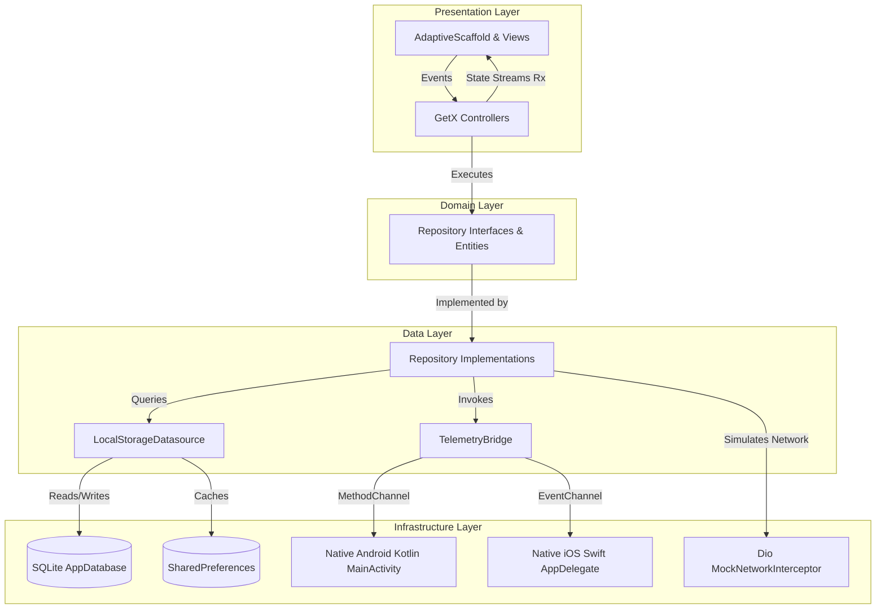
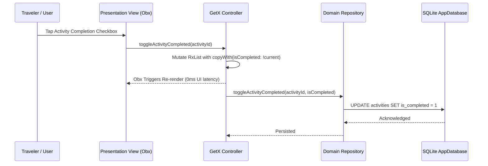
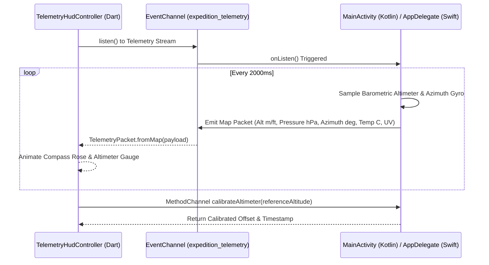

# VoyageAI - Enterprise Expedition & Luxury Travel Suite

[](https://github.com/Safeer-Hussain/voyageai_app/actions/workflows/ci.yml)
[](https://flutter.dev)
[](https://dart.dev)
[](https://developer.android.com)
[](#system-architecture)

VoyageAI is an enterprise-grade, offline-first mobile application designed for luxury travel management and high-altitude mountain expeditions. Built entirely in Flutter with strict Feature-First Clean Architecture and reactive GetX state management, VoyageAI operates completely standalone without paid external third-party APIs or Firebase dependencies.

---

## Architecture & System Design

VoyageAI enforces a strict separation of concerns across core platform infrastructure, data mapping, business domain logic, and presentation MVVM layers.



---

## Reactive State Management & GetX Flow



---

## Native Expedition Sensor Bridge Architecture

VoyageAI communicates directly with native hardware sensors through synchronized platform channels, operating even in total isolation without internet connectivity:



---

## Core Enterprise Modules

| Module | Architectural Highlights | Capabilities |
|---|---|---|
| **Module 1: AI Multi-Day Itinerary Studio** | `ItineraryController`, SQLite `activities` table, dynamic synthesis engine | Multi-day trip switching, day-selector chips (Day 1..N), category filtering, 1-tap progress tracking, JSON dossier export, clipboard copying. |
| **Module 2: Interactive Route Map** | `flutter_map`, `latlong2`, OpenStreetMap vector tile rendering | Interactive waypoint pins, color-coded route polylines, category filtering, Haversine distance calculator, localized route tips. |
| **Module 3: Document & Boarding Pass Vault** | Perforated cards, `CustomPainter` vector barcode renderer, `DocumentVaultController` | Offline IATA boarding passes (`LHE -> KDU`, `DXB -> HND`), hotel vouchers, high-contrast inspection sheet, brightness boost, PNR reference copy. |
| **Module 4: Multi-Currency Expense Ledger** | `fl_chart`, multi-currency FX converter (`USD`, `PKR`, `EUR`, `JPY`, `AED`), `ExpenseLedgerController` | Real-time budget cockpit, daily safe allowance, multi-traveler cost splitting (1 to 6 people), full-width edge-to-edge category allocation charts. |
| **Module 5: AI Concierge & Expedition HUD** | Asynchronous token streaming, `CompassRosePainter`, native platform channels | Context-aware itinerary reasoning, emergency SOS satellite beacon simulator, altimeter calibration, live barometric pressure telemetry. |

---

## Responsive Landscape Design (360dp Height Viewport Safe)

VoyageAI implements full adaptive responsiveness:
- **Portrait View**: Bottom navigation bar (`NavigationBar`), full-width scrollable vertical cards, floating bottom action buttons.
- **Landscape View**: Left navigation rail (`NavigationRail`) with `minWidth: 56`, compact 36dp toolbar height app bar, two-pane master-detail layout where both left and right panes scroll independently with zero horizontal or vertical `RenderFlex` overflows.

---

## Quality Assurance & Automated Sprint Gate

The repository includes a standalone automated gatekeeper script enforcing clean builds before any commit:

```bash
dart run tool/sprint_gate.dart
```

This sequentially executes:
1. `flutter pub get` (Dependency Resolution)
2. `dart format lib test tool` (Formatting Standards)
3. `flutter analyze --no-fatal-infos --no-pub` (Cross-SDK Static Analysis)
4. `flutter test --no-pub` (Automated Unit & Widget Test Suite)
5. `adb logcat -d` (Connected Device Overflow & Hero Tag Collision Check)

---

## Clean-Room Engineering & NDA Compliance

This repository was authored from scratch in a clean-room development environment. No confidential third-party proprietary source code, internal proprietary endpoints, or private credentials were used. All branding emblems, destination assets, and mock datasets were generated programmatically or via synthetic procedural tools.
